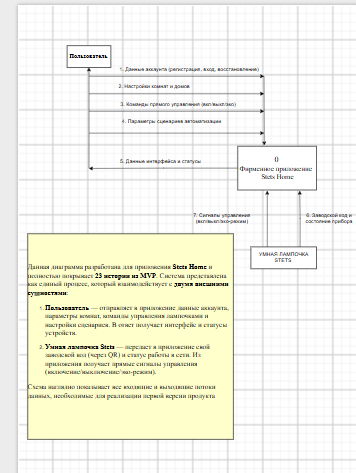
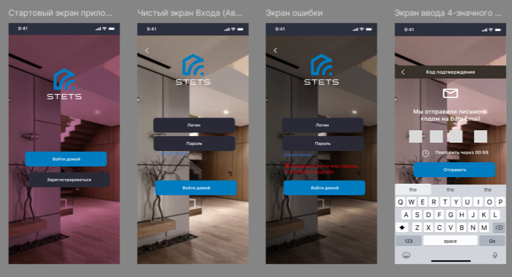
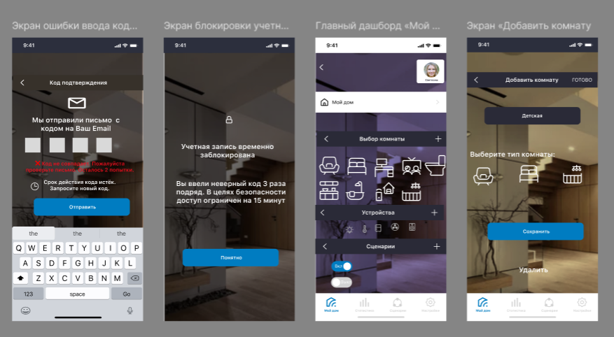
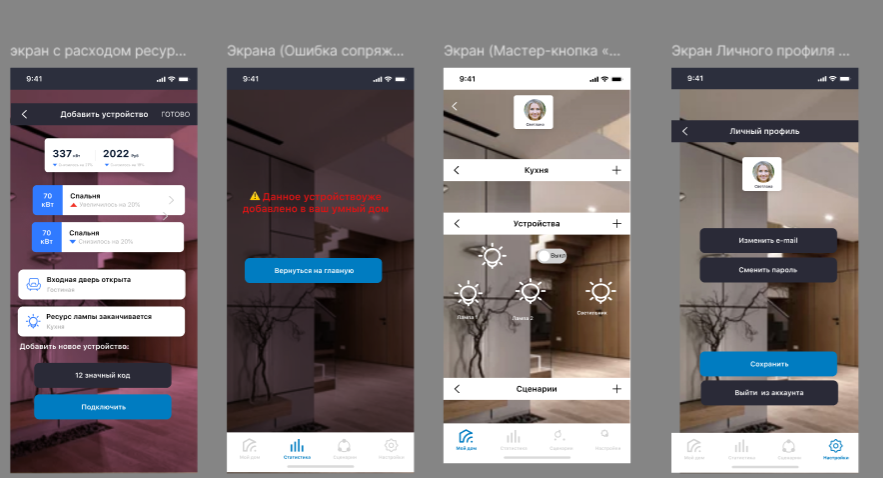
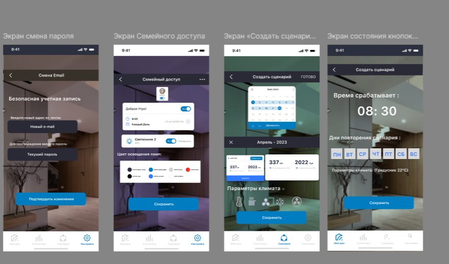

# 🏠 Проектирование MVP-версии IT‑платформы автоматизации «Умный дом» (Stets Home)

## 📝 О проекте

Дипломный проект по комплексному системному анализу и проектированию MVP платформы автоматизации «Умный дом».  
Скоуп MVP: удалённое управление умными устройствами (на примере ламп), настройка расписаний и автоматических сценариев.

Хотя функционал MVP ограничен, проект изначально проектировался как масштабируемая платформа: заложена расширяемая модель данных, описаны потоки интеграции и подготовлен полный пакет системной документации для последующих итераций.

---

## 📊 Ключевые результаты (Формула X, Y, W)

*   **Что сделано (X):**  
    *   Полный пакет проектной документации: SRS, ПМИ, словари данных.  
    *   Интерактивные прототипы и модели данных.  
*   **Масштаб (Y):**  
    *   27 пользовательских историй, декомпозированных на 8 эпиков для MVP.  
    *   Реляционная база данных из 11 взаимосвязанных таблиц, приведённая к 3НФ.  
*   **Бизнес‑ценность (W):**  
    Снижение времени на оценку и разработку бэкенда на 40%, исключение архитектурных ошибок на этапе MVP за счёт единой модели данных и чётких критериев приёмки.

---

## 🔀 Этапы работы над проектом

1.  **Сбор и декомпозиция требований.**  
    Провела интервью и анализ потребностей. Сформировала 27 пользовательских историй и декомпозировала их на 8 эпиков. Приоритизировала бэклог через User Story Mapping (USM). Для каждой истории заложила критерии приёмки и сценарии в Gherkin‑синтаксисе.
2.  **Моделирование данных (ERD).**  
    Построила ER‑диаграмму: от концептуальной модели к логической, затем к физической. Развёрнула базу из 5 базовых таблиц в полноценную реляционную структуру из 11 таблиц в 3НФ.  
    Устранила связи многие‑ко‑многим через соединительные таблицы (User_Home, Scenario_Device, Scenario_Day). Выделила справочники (Room_Type, Device_Type, Day_Of_Week). Добавила бизнес‑атрибуты: цвет, яркость, эко‑режим, статус сценария, целевой статус устройств.  
    Описала словари данных с типами, длинами и бизнес‑лимитами: до 5 участников на дом, до 10 домов на аккаунт, до 10 комнат в доме, до 30 ламп в комнате, до 10 сценариев на дом.
3.  **Моделирование потоков данных (DFD).**  
    Построила DFD двух уровней — контекстный (внешние сущности: Пользователь и Умная лампочка Stets) и логический (процессы, хранилища и потоки данных).  
    На итерации v1.1 доработала диаграмму: разорвала прямую связь между хранилищами (поток данных идёт только через процессы), разделила процессы управления домами и комнатами на независимые с отдельными хранилищами, подписала все потоки и сверила с ERD‑моделью.
4.  **Проектирование интерфейсов.**  
    Разработала диаграмму структуры приложения — определила состав экранов и логику переходов между ними.
5.  **Прототипирование в Figma.**  
    Создала интерактивные макеты экранов с переходами. Стейкхолдеры могли «кликнуть» по прототипу и согласовать UX до начала разработки.

> **Результат этапного подхода:** каждый шаг логически вытекал из предыдущего — от требований к модели данных, от модели к интерфейсам и прототипам. Это позволило избежать переделок и сократить время согласований.

---

## 🗺️ Артефакты

*   **SRS и ПМИ** — спецификация требований и план приёмо‑сдаточных испытаний.
*   **ER‑диаграмма** (концептуальная → логическая → физическая) — модель данных на 11 таблиц в 3НФ с PK/FK‑связями и бизнес‑лимитами.
*   **Словарь данных** — описание всех таблиц, полей, типов данных и ограничений по 4 зонам: Личный кабинет, Структура дома, Умные устройства, Автоматизация.
*   **DFD** — контекстный и логический уровни потоков данных (с итеративной доработкой v1.1).
*   **USM‑карта** — приоритизация бэклога MVP.
*   **Интерактивный прототип в Figma** — макеты экранов с переходами.

> Артефакты доступны для демонстрации на собеседовании.

## 🖼 Визуализация архитектуры и артефактов

### 1. Логическая ER-диаграмма базы данных (3НФ, 11 таблиц)

### 2. Диаграммы потоков данных (DFD)
**Контекстный уровень:**

**Логический уровень (v1.1):**

### 3. Вайрфреймы и макеты экранов (Figma)

---

## 📋 Инструкция по развёртыванию и системные требования

*   **Нотации:** DFD, ERD.
*   **БД:** SQL (синтаксис PostgreSQL / MS SQL Server).
*   **Инструменты:** Miro (USM), Figma (прототипы), Google Workspace, Git.
*   **Системные требования:** проект не требует развёртывания — все артефакты представляют собой проектную документацию, диаграммы и прототипы. Для просмотра диаграмм достаточно браузера, для SQL‑скриптов — любая СУБД с поддержкой PostgreSQL или MS SQL Server.
