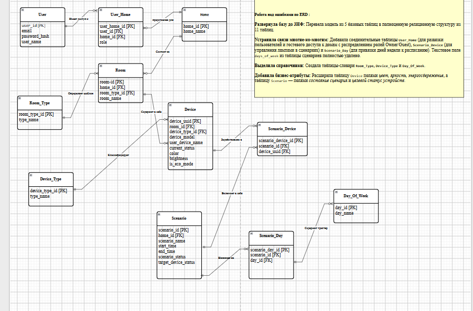
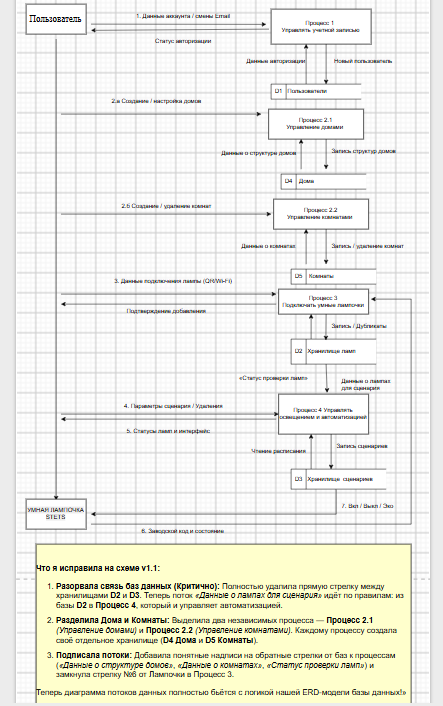

# 🏠 Проектирование MVP-версии IT‑платформы автоматизации «Умный дом» (Stets Home)

## Содержание

1. [О проекте](#о-проекте) — бизнес-контекст, проблема и цель разработки
2. [Заметки на полях](#заметки-на-полях) — продуктовые компромиссы, итерации и AI-инструменты
3. [Ключевые результаты](#ключевые-результаты) — метрики и объём проделанной работы
4. [Этапы проектирования](#этапы-проектирования) — от интервью до тестирования прототипа
5. [Визуализация архитектуры и прототипа](#визуализация-архитектуры-и-прототипа) — ER, DFD и экраны Figma
6. [Состав репозитория](#состав-репозитория) — документация и артефакты проекта

## О проекте

**Заказчик / продукт** — компания **Stets**, производитель умных электронных устройств, разработавшая инновационный программно-аппаратный режим энергосбережения для умных ламп.

**Проблема** — сторонние экосистемы управления умным домом (Google Home, Apple Home) не поддерживали активацию фирменного режима энергосбережения Stets, что лишало продукт главного конкурентного преимущества.

**Цель проекта** — с нуля спроектировать требования, архитектуру данных, логику потоков и интерактивный прототип мобильного приложения **Stets Home (MVP v1.1)** для удалённого управления освещением, комнатами и сценариями автоматизации.

**Инструменты и нотации:** User Story Mapping (USM), Gherkin, ERD (Crow's Foot, 3НФ), DFD, Figma (UI-kit), ПМИ.

## Заметки на полях

**Продуктовые компромиссы при формировании скоупа MVP**

В ходе интервью с представителем заказчика и глубинными пользователями (выделены 2 персоны) было выявлено множество пожеланий, но для соблюдения сроков релиза MVP часть функций была осознанно вынесена во вторую итерацию:
- **Включено в MVP:** регистрация и 2FA-авторизация, автоматическое создание первого дома при регистрации, совместный семейный доступ (до 5 человек), добавление ламп по QR или 12-значному коду с проверкой дублей, управление комнатами (до 10 на дом), мастер-кнопка света в комнате, простые сценарии по расписанию и главный фокус — **режим энергосбережения**.
- **Вынесено за рамки MVP (v2):** тонкая настройка цвета и яркости ламп, таймеры обратного отсчёта, поддержка умных розеток и устройств сторонних производителей.

**Архитектурные решения с запасом на масштабирование**

1. **Проектирование БД в 3НФ (11 таблиц):** от концептуальной модели из 5 базовых сущностей (Пользователь, Дом, Комната, Устройство, Сценарий) модель развёрнута в полноценную логическую структуру из 11 таблиц. Связи «многие-ко-многим» развязаны через промежуточные таблицы (`User_Home`, `Scenario_Device`, `Scenario_Day`), а повторяющиеся значения вынесены в справочники (`Room_Type`, `Device_Type`, `Day_Of_Week`). Это позволяет в будущем подключать новые типы устройств без перестройки базы данных.
2. **Детализация потоков данных (DFD):** логический уровень схемы спроектирован с чётким разделением процессов управления домами и комнатами, а все потоки данных строго согласованы с атрибутами ER-диаграммы.

**AI-assisted**

В работе применялись LLM-инструменты для проверки граничных условий в сценариях Gherkin, валидации типов данных в словаре и проверки негативных тест-кейсов безопасности в ПМИ.

## Ключевые результаты

- **27 пользовательских историй (User Stories)** декомпозированы на 8 эпиков с критериями приёмки в синтаксисе Gherkin.
- **11 таблиц в 3НФ** спроектированы в логической модели БД со словарём на 40+ атрибутов и бизнес-лимитами (до 10 домов, до 10 комнат, до 100 устройств, до 10 сценариев).
- **16 экранов интерактивного прототипа** собраны в Figma на базе фирменной дизайн-системы, включая негативные сценарии безопасности (блокировка на 15 минут после 3 неверных попыток ввода кода 2FA).
- **11 сквозных сценариев тестирования (TR-1.1 — TR-5.1)** оформлены в Программе и методике испытаний (ПМИ).
- **-40% времени на оценку и разработку бэкенда** за счёт устранения архитектурных противоречий до старта кодирования.

## Этапы проектирования

1. **Исследование и сбор требований.** Анализ конкурентов (Google Home, Apple Home), интервью с заказчиком и пользователями, выделение персон, приоритизация бэклога на карте USM и написание ТЗ (SRS).
2. **Моделирование данных (ERD) и словарь.** Построение концептуальной и логической ER-модели в 3НФ с описанием первичных/внешних ключей и ограничений системы.
3. **Моделирование потоков данных (DFD).** Проектирование контекстного и логического уровней взаимодействия между пользователем, приложением Stets Home и умной лампочкой.
4. **Прототипирование в Figma.** Разработка структуры навигации и раскадровки из 16 экранов с переходом на мастер-компонентах дизайн-системы.
5. **Верификация по ПМИ.** Проверка всех позитивных и негативных сценариев работы прототипа на соответствие требованиям ТЗ.

## Визуализация архитектуры и прототипа

### 1. Логическая ER-диаграмма базы данных (3НФ, 11 таблиц)

**Ключевые решения при проектировании БД (3НФ, 11 таблиц):**
* **Развязка связей «многие-ко-многим»:** внедрены соединительные таблицы `User_Home` (семейный доступ с ролями `Owner`/`Guest`), `Scenario_Device` (состав сценариев) и `Scenario_Day` (гибкое расписание без хранения списков в тексте).
* **Нормализация через справочники:** повторяющиеся значения вынесены в словари `Room_Type`, `Device_Type` и `Day_Of_Week` для удобного масштабирования системы.
* **Бизнес-атрибуты:** в таблицу `Device` заложены параметры энергосбережения (`is_eco_mode`), цвета и яркости, а в `Scenario` — статус активности и целевое состояние приборов.

### 2. Диаграммы потоков данных (DFD)
**Контекстный уровень:**

**Назначение контекстного уровня DFD:**
* Определены границы системы `Stets Home` и её взаимодействие с двумя внешними сущностями — **Пользователем** и **Умной лампочкой Stets**.
* Зафиксированы все входящие и исходящие потоки данных (регистрация, управление комнатами и сценариями, заводской код устройства и команды энергосбережения).

**Логический уровень (v1.1):**

**Архитектура потоков данных на логическом уровне:**
* **Декомпозиция процессов и хранилищ:** управление домами (`Процесс 2.1`) и комнатами (`Процесс 2.2`) разделено на независимые потоки со своими базами (`D4 Дома` и `D5 Комнаты`).
* **Изоляция баз данных:** обмен данными между хранилищами `D2` (Лампы) и `D3` (Сценарии) проходит строго через управляющий `Процесс 4` (Автоматизация) без прямых связей между собой.
* **Согласованность с ER-моделью:** детально описаны обратные потоки данных от хранилищ к процессам и замкнут поток телеметрии от лампы в `Процесс 3` (Подключение устройств).

### 3. Вайрфреймы и макеты экранов (Figma)
**Авторизация, 2FA и обработка ошибок входа:**

**Блокировка безопасности, главный дашборд и создание комнат:**

**Статистика расхода энергии, мастер-кнопка света и профиль:**

**Смена данных, семейный доступ и настройка сценариев по расписанию:**

## Состав репозитория

| Файл | Описание |
| :--- | :--- |
| [Спецификация требований к ПО (SRS) _ Платформа Умный дом.pdf](Спецификация%20требований%20к%20ПО%20(SRS)%20_%20Платформа%20Умный%20дом.pdf) | ТЗ на разработку MVP: 27 пользовательских историй (Gherkin), нефункциональные требования и критерии приёмки |
| [Словарь данных и структура БД _ Платформа Умный дом.pdf](Словарь%20данных%20и%20структура%20БД%20_%20Платформа%20Умный%20дом.pdf) | Подробное описание всех 11 таблиц БД, атрибутов, типов данных и бизнес-лимитов |
| [PMI_Stets_Home.pdf](PMI_Stets_Home.pdf) | Программа и методика испытаний (ПМИ): 11 тестовых сценариев для проверки прототипа |
| `er-diagram.png.png`, `dfd-context.png.png`, `dfd-logical.png.png` | Архитектурные схемы БД и потоков данных |
| `screen-1.png.png` — `screen-4.png.png` | Макеты 16 экранов интерактивного прототипа из Figma |
| `README.md` | Этот файл |
